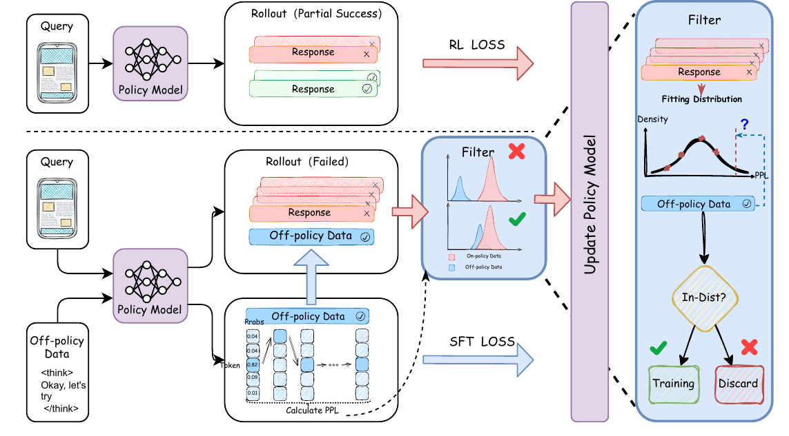
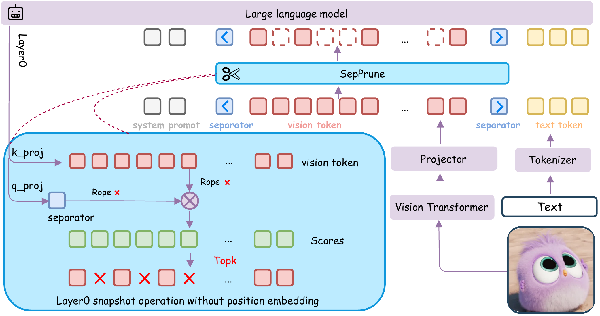
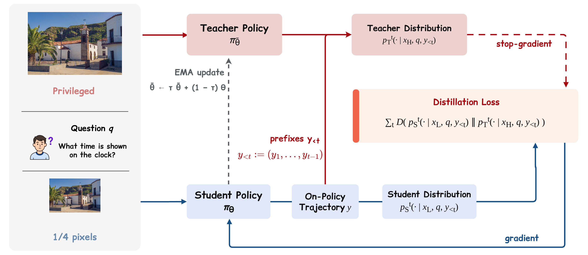
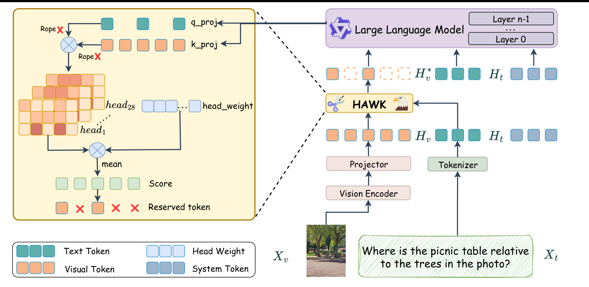








# About Me 🚀
I am an M.S. student in Computer Technology at the University of Science and Technology of China (USTC), expecting to graduate in June 2027. My research focuses on **LLM post-training, reinforcement learning for reasoning, and efficient multimodal inference**.

I am currently a **Research Intern at [Unipat](https://unipat.ai/)**, focusing on **visual coding, data synthesis, and benchmark development and evaluation**. I am open to academic collaborations in these areas, as well as LLM post-training and efficient multimodal inference. Please feel free to contact me.

  Visual Coding
  Data Synthesis
  Benchmarking
  LLM Post-training
  Efficient MLLM Inference
  Open to Collaboration

Contact 📫: `wangyuc@mail.ustc.edu.cn`
GitHub 🐙: [https://github.com/sansanyuchen](https://github.com/sansanyuchen)

# News 📰
- *2026.10* Joined **[Unipat](https://unipat.ai/)** as a Research Intern.
- *2026.08* **APEX** was accepted by **EMNLP 2026** (First Author).
- *2026.07* **RP-OPSD** was released on arXiv and submitted to **AAAI 2027** (Co-first Author).
- *2026.04* Joined **ByteDance Data - Douyin** as an Application Algorithm Intern.
- *2026.03* **SepPrune** was accepted by **ICME 2026** (First Author).
- *2026.03* **HAWK** was accepted by **CVPR 2026**.

# Education 🎓
- *Sep. 2024 – Jun. 2027 (expected)* Master, Computer Technology, University of Science and Technology of China  
  Advisor: Prof. Xiaoyan Sun · [Vision Intelligence Laboratory (ViLab)](https://vilab.team/)
- *2020.09 - 2024.06* Bachelor, New Energy Science and Engineering, North China Electric Power University

# Internship Experience 💼

  

    <svg class="internship-logo" viewBox="0 0 425.15 425.2" fill="currentColor" role="img" aria-label="UniPat AI" xmlns="http://www.w3.org/2000/svg"><g>
    <path d="M347.16,116.08c-9.49,0-28.49,0-37.99,0-33.71,0-62.79,21.43-73.42,53.38l-65.42,196.68c-7.3,21.67-29.39,33.99-51.38,28.66-11.99-2.91-21.9-10.52-27.9-21.42-6.01-10.91-7.19-23.45-3.27-35.49l24.66-79.26c5.29-16.27,1.18-33.89-10.71-46.04l-61.95-65.94,78.31,2.95c27.26.41,50.15-12.52,61.4-34.88.11-.21.21-.44.31-.66l30.58-69.24,26.37,62.31c3.13,7.4,11.59,10.83,18.89,7.66,7.3-3.17,10.69-11.74,7.56-19.14L227.5,11.3C224.66,4.58,218.41.25,211.19,0c-7.18-.21-13.74,3.66-17.01,10.18-.11.22-.22.44-.32.66l-40.16,90.95c-6.28,12.18-19.01,19.01-34.81,18.68l-97.07-3.66c-8.68-.34-16.57,4.69-20.05,12.78-3.45,8.01-1.77,17.18,4.25,23.41l74.97,79.8c.08.08.17.17.25.26,4.28,4.33,5.76,10.63,3.81,16.63l-24.66,79.26c-6.31,19.41-4.3,40.77,5.53,58.62,9.82,17.85,26.71,30.81,46.33,35.57,5.73,1.39,11.45,2.06,17.1,2.06,30.31,0,58-19.32,68.24-49.7l65.43-196.73c6.69-20.09,25.34-33.16,46.21-33.56,13.2-.25,26.93-.68,37.9,0,27.33,1.69,49.24,22.66,49.24,49.98,0,5.52-.21,17.51-7.19,26.6-8.36,10.9-20.51,15.18-28.69,16.23-10.84,1.4-32.8,0-43.73,0-9.93,0-20.17,4.44-26.26,12.92-6.1,8.47-7.63,19.42-4.17,29.05l34.72,101.79-61.64-47.87c-6.67-5.18-16.39-3.53-20.97,3.86-4.01,6.48-2,15.02,4.01,19.69l76.3,59.26c8.11,6.53,19.21,6.8,27.62.66,8.41-6.13,11.68-16.87,8.22-26.51l-41.14-120.61c-.27-.77-.17-1.5.31-2.16.47-.66,1.06-.95,2.76-.96,9.95-.02,29.11-.11,39.8,0,19.3.2,36.14-7.27,48.24-18.78,14.12-13.43,20.57-32.08,20.59-53.14C425.19,151.63,390.2,116.11,347.16,116.08ZM336.45,393.75l-.1-.08L336.45,393.75ZM327.47,400.6s-.04-.09-.05-.14C327.43,400.51,327.45,400.56,327.47,400.6ZM347.16,116.08c-9.7-.39-27.06-.25-37.99,0-33.7.8-62.79,21.43-73.42,53.38"/>
  </g></svg>
    

      

        

          
<a href="https://unipat.ai/">Unipat</a>

          
Research Intern · Visual Coding

        

        
2026.10 - Present

      

      
Visual CodingData SynthesisBenchmarking

      
My work at Unipat focuses on visual coding, data synthesis, and benchmark development and evaluation.

    

  

  

    
    

      

        

          
ByteDance Data - Douyin

          
Application Algorithm Intern · LLM Post-training

        

        
2026.04 - 2026.10

      

      
Customer Service ModelsSeed/Qwen LLMsRL Post-training

      
I worked on post-training algorithms for customer service foundation models across ByteDance apps. My work combined Seed/Qwen-series LLMs with customer-service dialogue data, business knowledge bases, and multi-turn interaction logs to build reinforcement learning pipelines for improving task-oriented response quality and model behavior.

    

  

  

    
    

      

        

          
Alibaba Qwen (C-end)

          
Algorithm Intern · LLM Post-training

        

        
2025.09 - 2026.02

      

      
SFT + GRPOPPL WeightingVerifier Training

      
I explored a unified <code>SFT + GRPO</code> framework for reasoning-oriented post-training and proposed a PPL-based adaptive loss weighting method to balance supervision and exploration on difficult samples. The approach outperformed baselines on AIME24/25 and out-of-domain reasoning benchmarks. I also built an end-to-end verification model based on <code>Qwen3-235B-A22B</code>, using data flywheel signals, majority voting, reward design, and online curriculum learning to train from weakly labeled data; the system reached <strong>95.7% precision / 63.2% recall</strong> in offline evaluation and supported Qwen/Quark education scenarios.

    

  

  

    
    

      

        

          
Huawei Noah's Ark Lab

          
Algorithm Intern · MLLM

        

        
2025.05 - 2025.09

      

      
Efficient MLLMToken PruningTraining-free Inference

      
I focused on efficient multimodal inference for high-resolution MLLM inputs, designing training-free visual token pruning methods to reduce latency and memory cost without modifying model architectures. I developed two plug-and-play pruning frameworks around separator-token anchoring and head-importance-aware scoring; on Qwen2.5-VL-style models, the methods preserved strong performance under aggressive token reduction and led to <strong>ICME 2026</strong> and <strong>CVPR 2026</strong> publications.

    

  

# Publications 📚

  

    

      
    

    

      
APEX: Adaptively Balancing Off-Policy Guidance and On-Policy Exploration for LLM Reasoning

      
<strong>Yuchen Wang</strong>, et al. First author

      
University of Science and Technology of China.

      
EMNLP 2026Accepted

    

  

  

    
    

      
SepPrune: A Separator-based Pruning Framework for Efficient Multimodal Large Language Models

      
<strong>Yuchen Wang</strong>, Qihui Zhu, Yang Liu, Xiaoyan Sun, Siying Wu. First author

      
University of Science and Technology of China; Hefei Comprehensive National Science Center; ChangXin Memory Technologies.

      
ICME 2026Accepted<a href="https://arxiv.org/abs/2607.25818">arXiv</a>

    

  

  

    
    

      
RP-OPSD: Resolution-Privileged On-Policy Self-Distillation for Multimodal Large Language Models

      
Qihui Zhu, <strong>Yuchen Wang</strong>, Zijian Wen, Tao Zhang, Mengjie Zhang, Yang Liu, Shuangwu Chen, Siying Wu, Jian Yang, Xiaofeng Jiang. Co-first author

      
University of Science and Technology of China; ChangXin Memory Technologies, Inc.

      
AAAI 2027Under review<a href="https://arxiv.org/abs/2607.24447">arXiv</a><a href="https://github.com/sansanyuchen/RP-OPSD">Code</a>

    

  

  

    
    

      
HAWK: Head Importance-Aware Visual Token Pruning in Multimodal Models

      
Qihui Zhu, Tao Zhang, <strong>Yuchen Wang</strong>, Shuangwu Chen, Xiaobin Tan, Jian Yang, Yang Liu, Yinfei Pan.

      
University of Science and Technology of China; ChangXin Memory Technologies, Inc.; Huawei Noah's Ark Lab.

      
CVPR 2026Accepted<a href="https://arxiv.org/abs/2604.07812">arXiv</a>

    

  

# Skills 🧠
- Core: LLM Post-training, RLHF, PPO, GRPO, DPO, CoT Reasoning, Data Synthesis
- Frameworks: PyTorch, Verl, Swift, vLLM, Transformers

# Research Interests 🔍
- LLM Post-training
- RLHF / PPO / GRPO / DPO
- CoT Reasoning for complex tasks
- Efficient Inference for MLLMs (training-free visual token pruning)

# Honors and Awards 🏆
- *2025* First-Class Academic Scholarship, USTC
- *2022* Second Prize, Beijing Division of China Undergraduate Mathematical Contest in Modeling (CUMCM)
